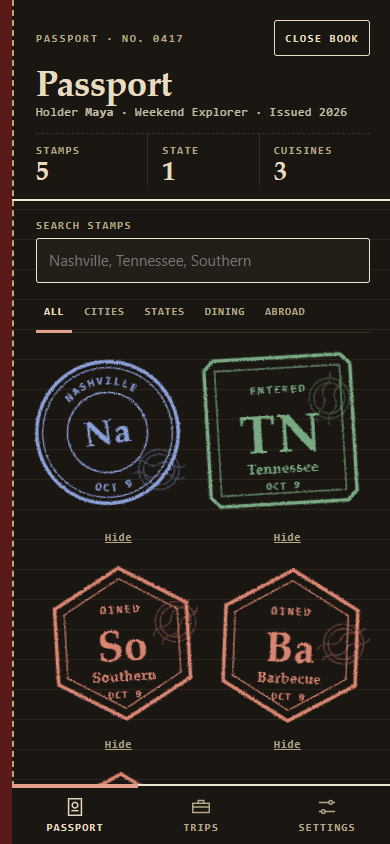

# Passport stamp book

**A product concept, built end to end:** a stamp-book for everyday trips and meals, styled as a physical passport. It started as a product requirements document and became a working prototype, with a mock backend and 76 automated tests.

> Independent portfolio concept. Fake data only. It is **not affiliated with, or endorsed by, any card issuer**, uses no issuer branding, and contains no real customer data.

| Cover | Passport | Stamp detail |
|---|---|---|
|  |  |  |

| Trip recap (boarding pass) | Night mode | Desktop |
|---|---|---|
|  |  |  |

## The problem

Digital travel stamps exist, but they reward only international trips. People who travel abroad once a year, or never, have nothing to come back to between trips, even though they eat out and travel within their own country all the time.

**The concept:** earn stamps for *dining* (a new cuisine, a meal in a new city) and *domestic travel* (a new city or state), and turn every trip into a shareable boarding-pass recap. The full reasoning, personas, metrics, experiment plan and risks are in the [product requirements document](docs/PRD.md) (8 pages).

## What the prototype does

- **Stamps from card activity** with real rules: posted purchases only, a $5 minimum, trips more than 75 miles from home, no guessed cuisines, nothing for refunded or disputed purchases.
- **Pressed-ink stamps**: four shapes (round city, boxed state, hexagonal dining, double-ring country), ink-bleed edges, postmarks, drawn entirely in SVG.
- **Stamp detail**: the purchases that earned it, with amounts shown only there. Hide a stamp or report a wrong one.
- **Search and filter**, plus a back-of-book **index** (50 states, 20 cuisines).
- **Trip recap as a boarding pass** with route, barcode and places timeline. Trips are detected automatically (a pause of more than two days starts a new one), each with its own recap and name, and an **All trips** list to revisit past ones. **Share or save it as an image**; amounts and card details never appear, restaurant names are opt-in.
- **Three-step onboarding** that states the privacy promises before asking for any choice.
- **Offline mode**: cached snapshot, paused changes, queued edits that sync on reconnect, all surviving a reload.
- **Mock backend**: sign-in, a transaction feed per persona and server-side preferences.
- **Night mode**, reduced-motion support, keyboard and screen-reader support.
- **Demo controls** (bottom of each screen): switch between four personas, go offline, refund or dispute a purchase and watch the stamps react.

## Run it

No build step.

```bash
# Option 1: just open index.html in a browser (built-in data, no sign-in)

# Option 2: with the mock backend (sign in with demo / demo)
npm start                       # http://localhost:3000
HOST=0.0.0.0 npm start          # to try it from your phone on the same Wi-Fi
```

On first open, tap the cover, walk through onboarding, then try **Demo controls → Simulate card activity**.

## Tests

```bash
npm test            # 39 unit + API tests (Node built-in runner, no dependencies)
npm install         # once, for the browser tests
npm run test:ui     # browser tests (Puppeteer) incl. an axe accessibility audit
npm run test:layout # text-fit audit at six widths, light and night
```

| Suite | What it covers |
|---|---|
| `tests/unit/rules.test.js` | Every product rule: posted-only, minimum amount, distance, no guessed cuisine, refund and dispute, per-persona isolation, recap, dates |
| `tests/unit/data.test.js` | The browser data file and the server data file stay identical and well-formed |
| `server.test.js` | Login, per-session state, 401/404/405/413/415, input validation, static-file allowlist and path traversal |
| `tests/ui/app.ui.mjs` | Onboarding, stamps, hide/restore, dialog behaviour, search, recap, privacy defaults, share and save, offline, corrupted saved state, focus handling, reduced motion |
| `tests/ui/a11y.ui.mjs` | WCAG 2.0/2.1 A and AA on every screen, in light and night, at phone and desktop widths |
| `tests/ui/api.ui.mjs` | The front end against the real mock backend |
| `tests/ui/layout.ui.mjs` | Text fits: at 6 widths (320 to 1280px), in light and night, on every screen, nothing overflows the page, leaves its container or is clipped |

Set `CHROME_PATH` if Chrome or Edge is not in a default location.

## How it is built

```
index.html            shell
css/                  tokens (palette, type), book (layout, cover, ticket), stamps
js/rules.js           pure product rules; also loaded by Node for unit tests
js/stamps-art.js      SVG stamps, crest, barcode; canvas share image
js/store.js           state, localStorage, API sync
js/views.js           render functions (every dynamic value is escaped)
js/main.js            boot and event handling
server.js             zero-dependency mock API (sessions, validation, limits)
tests/                unit and browser tests
docs/                 PRD, design decisions, screenshots
```

Vanilla JavaScript with classic scripts, so it also works from `file://`. No framework, no bundler, no runtime dependencies.

## Design

The app is a passport book rather than a dashboard: cover, ruled pages, ink-bled stamps, a boarding-pass recap. No gradients, no emoji, no pill chips. The reasoning, the rules I set myself and the accessibility choices are in [docs/design-decisions.md](docs/design-decisions.md).

## Known limits

- **Not tested on a real phone or with a real screen reader.** The share sheet path is covered by a mocked test, and accessibility by automated audits, which catch only part of the problems.
- The backend is a mock: one demo login, in-memory sessions, fake data. A real build would use real authentication, a card-transaction feed and rate limiting.
- Trip detection is a simple rule (a gap of more than two days between away-from-home purchases). It does not yet merge multi-city itineraries or use destination changes.
- Stamps are app-only. The PRD discusses, and defers, putting any stamp on a blockchain.

## License

[MIT](LICENSE)
