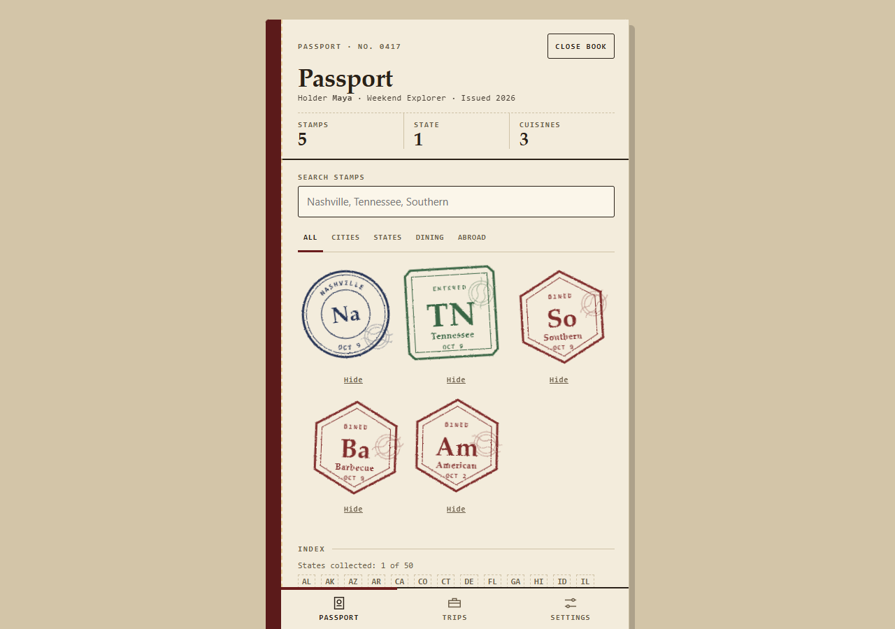

# Passport stamp book

**A product concept, built end to end:** a stamp-book for everyday trips and meals, styled as a physical passport. It started as a product requirements document and became a working prototype, with a mock backend and 104 automated tests plus a lint check.

> Independent portfolio concept. Fake data only. It is **not affiliated with, or endorsed by, any card issuer**, uses no issuer branding, and contains no real customer data.

| Cover | Passport | Stamp detail |
|---|---|---|
|  |  |  |

| Trip recap (boarding pass) | Night mode | Desktop |
|---|---|---|
|  |  |  |

## The problem

Digital travel stamps exist, but they reward only international trips. People who travel abroad once a year, or never, have nothing to come back to between trips, even though they eat out and travel within their own country all the time.

**The concept:** earn stamps for *dining* (a new cuisine, a meal in a new city) and *domestic travel* (a new city or state), and turn every trip into a shareable boarding-pass recap. The full reasoning, personas, metrics, experiment plan and risks are in the [product requirements document](docs/PRD.md) (8 pages).

## What the prototype does

- **Stamps from card activity** with real rules: posted purchases only, a $5 minimum, trips more than 75 miles from home, no guessed cuisines, nothing for refunded or disputed purchases.
- **Pressed-ink stamps**: four shapes (round city, boxed state, hexagonal dining, double-ring country), ink-bleed edges, postmarks, drawn entirely in SVG.
- **Stamp detail**: the purchases that earned it, with amounts shown only there. Hide a stamp or report a wrong one.
- **Search and filter**, plus a back-of-book **index** (50 states, 20 cuisines).
- **Trip recap as a boarding pass** with route, barcode and places timeline. Trips are detected automatically (a pause of more than two days starts a new one), each with its own recap and name, and an **All trips** list to revisit past ones. **Share or save it as an image**; amounts and card details never appear, restaurant names are opt-in.
- **Three-step onboarding** that states the privacy promises before asking for any choice.
- **Offline mode**: cached snapshot, paused changes, queued edits that sync on reconnect, all surviving a reload.
- **Mock backend**: sign-in, a transaction feed per persona and server-side preferences.
- **Night mode**, reduced-motion support, keyboard and screen-reader support.
- **Collection goals** (3 and 5 states, 5 cities, 5 cuisines, first country) with progress bars and a seal when finished.
- **Privacy centre**: export your data (no amounts, no merchant names) or delete it, with a two-step confirmation.
- **Notification preferences** with previews of the exact message. Off until chosen. The prototype sends nothing.
- **Hide a place from a recap**; it also leaves the share image.
- **Installable and offline**: web manifest and a service worker that caches only the static shell, never the API.
- **Prototype tools** (bottom of Settings, collapsed; add `?demo=1` to the address to show them on every tab): switch between four travellers, go offline, refund or dispute a purchase and watch the stamps react.

## Run it

No build step.

```bash
# Option 1: just open index.html in a browser (built-in data, no sign-in)

# Option 2: with the mock backend (sign in with demo / demo)
npm start                       # http://localhost:3000
HOST=0.0.0.0 npm start          # to try it from your phone on the same Wi-Fi
```

On first open, tap the cover, walk through onboarding, then open **Settings → Prototype tools → Pretend a purchase changed**.

## Tests

```bash
npm test            # unit + API tests (Node built-in runner, no dependencies)
npm run lint        # ESLint
npm install         # once, for the browser tests
npm run test:ui     # browser tests (Puppeteer) incl. an axe accessibility audit
npm run test:layout # text-fit audit at six widths, light and night
npm run screenshots # regenerate the images in docs/
```

| Suite | What it covers |
|---|---|
| `tests/unit/rules.test.js` | Every product rule: posted-only, minimum amount, distance, no guessed cuisine, refund and dispute, per-persona isolation, recap, dates |
| `tests/unit/data.test.js` | The browser data file and the server data file stay identical and well-formed |
| `server.test.js` | Login, per-session state, 401/404/405/413/415, input validation, static-file allowlist and path traversal |
| `tests/ui/app.ui.mjs` | Onboarding, stamps, hide/restore, dialog behaviour, search, recap, privacy defaults, share and save, offline, corrupted saved state, focus handling, reduced motion |
| `tests/ui/a11y.ui.mjs` | WCAG 2.0/2.1 A and AA on every screen, in light and night, at phone and desktop widths |
| `tests/ui/api.ui.mjs` | The front end against the real mock backend |
| `tests/ui/layout.ui.mjs` | Text fits: at 6 widths (320 to 1280px), in light and night, on every screen, nothing overflows the page, leaves its container or is clipped |

Set `CHROME_PATH` if Chrome or Edge is not in a default location.

## How it is built

```
index.html            shell (carries the Content-Security-Policy)
sw.js, manifest.webmanifest, icon.svg   offline support and install
css/                  tokens (palette, type), book (layout, cover, ticket), stamps
js/rules.js           pure product rules; also loaded by Node for unit tests
js/stamps-art.js      SVG stamps, crest, barcode; canvas share image
js/store.js           state, localStorage, API sync
js/views.js           render functions (every dynamic value is escaped)
js/main.js            boot and event handling
js/config.js          deployment switch (static mode for hosts with no backend)
js/boot.js            service worker registration
server.js             zero-dependency mock API (sessions, validation, limits)
tests/                unit and browser tests
docs/                 PRD, design decisions, screenshots
```

Vanilla JavaScript with classic scripts, so it also works from `file://`. No framework, no bundler, no runtime dependencies.

## Live demo and deployment

**Vercel (static demo).** `vercel.json` already holds the build (`node scripts/build-static.mjs`), the output folder (`_site`) and the security headers, so there is nothing to configure:

```bash
npx vercel          # first run: log in and answer the prompts (framework: Other); gives a preview URL
npx vercel --prod   # publishes to the production URL
```

Or import the GitHub repository in the Vercel dashboard and every push to `main` deploys. Vercel's *Deployment Protection* is on by default for new projects; to make the demo publicly viewable, turn off **Vercel Authentication** in Project → Settings → Deployment Protection.

A static copy of the app (built-in fake data, no sign-in, no backend) can be published with GitHub Pages: `.github/workflows/pages.yml` lints, tests and publishes only the front-end files, and switches `js/config.js` to static mode. In the repository settings choose **Pages → Source: GitHub Actions**. The mock backend (`npm start`) is for local use only and is not deployed.

## Security and transparency

What is in place:
- **No runtime dependencies** and `npm audit` reports 0 vulnerabilities. The only dev dependencies are ESLint, Puppeteer and axe-core.
- **Strict Content-Security-Policy** (no inline scripts, no `eval`, no remote origins, no plugins, framing denied) sent as a header by the server and also embedded in the page for static hosts. A browser test proves an injected script and an injected inline event handler do not run.
- Every dynamic value is HTML-escaped before it reaches the page; saved browser state is type-checked on load.
- The server sends `nosniff`, `no-referrer`, `X-Frame-Options: DENY`, `Permissions-Policy` and `COOP` on every response, serves only an allowlist of static files (path traversal is tested), caps request sizes and sessions, compares credentials in constant time, and listens on localhost unless you set `HOST`.
- The service worker never caches `/api` and only deletes its own caches.
- Shared recap images and data exports never contain amounts or card details; restaurant names are opt-in.
- No secrets, API keys, personal data or real customer data are in the repository. All data is fake.

What is not, stated plainly:
- **The backend is a mock.** One public demo login (`demo` / `demo`), in-memory sessions, no rate limiting on sign-in, no HTTPS. Do not expose it to the internet or put real data in it. Setting `HOST=0.0.0.0` makes it reachable by anyone on your network.
- The sign-in token is kept in `localStorage`, so a successful script injection (which the CSP is there to prevent) could read it. A real product would use an HttpOnly cookie.
- The CSP allows inline *styles* (the views set a few style attributes). Scripts are strictly self-only.
- The Pages workflow uses GitHub's own actions pinned to major versions, not to commit hashes.
- Not tested on a real phone or with a real screen reader (see Known limits). Automated checks cover part of accessibility only.
- This is a self-review plus a scoped AI review (OpenAI Codex), not an independent human audit. What was checked, the three Low findings and what was done about each, and the known weaknesses are in [docs/SECURITY-REVIEW.md](docs/SECURITY-REVIEW.md). One finding is deliberately left: the GitHub Pages copy cannot send anti-framing headers, so use the Vercel deployment as the public link.

To report a problem, open an issue (this is a portfolio prototype, with no bounty or SLA).

## How this was made

Built by the repository owner working with AI coding tools: Claude Code wrote and revised most of the code and tests, and OpenAI Codex was used as a second reviewer. Commits made with Claude carry a `Co-Authored-By` line. The product thinking in [docs/PRD.md](docs/PRD.md) is the owner's; every number in it that is not cited is marked as an assumption.

## Design

The app is a passport book rather than a dashboard: cover, ruled pages, ink-bled stamps, a boarding-pass recap. No gradients, no emoji, no pill chips. The reasoning, the rules I set myself and the accessibility choices are in [docs/design-decisions.md](docs/design-decisions.md).

## Known limits

- **Not tested on a real phone or with a real screen reader.** The share sheet path is covered by a mocked test, and accessibility by automated audits, which catch only part of the problems.
- The backend is a mock: one demo login, in-memory sessions, fake data. A real build would use real authentication, a card-transaction feed and rate limiting.
- Trip detection is a simple rule (a gap of more than two days between away-from-home purchases). It does not yet merge multi-city itineraries or use destination changes.
- Notification settings are saved on the device only and no notification is ever sent.
- There is no share image for a single stamp yet (see the roadmap).
- Stamps are app-only. The PRD discusses, and defers, putting any stamp on a blockchain.

## License

[MIT](LICENSE)
