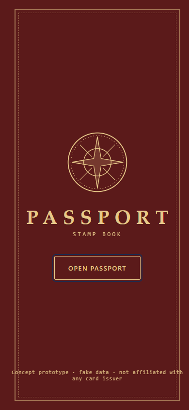
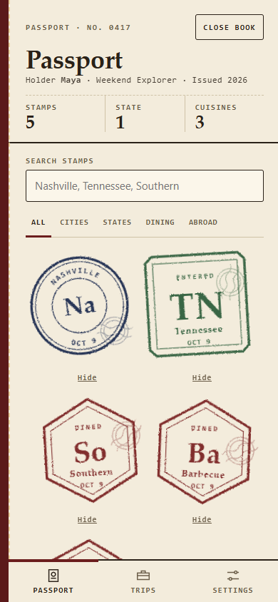
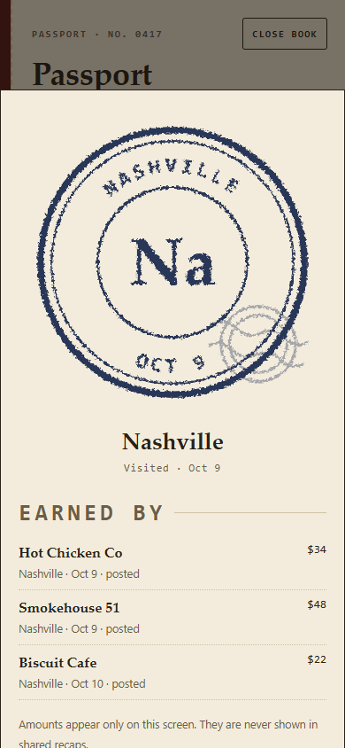
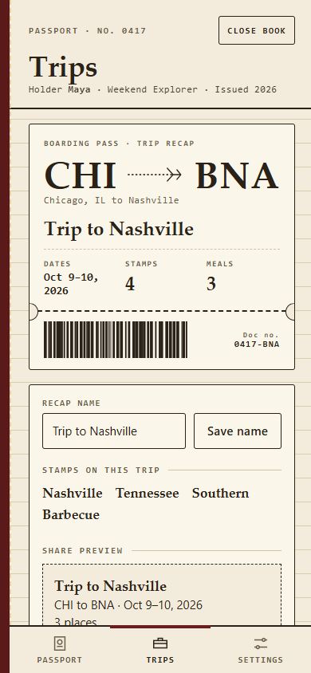

# Passport stamp book

A small web app that turns everyday trips and meals into stamps in a passport-style book. It started as a product requirements doc and I built a working prototype to test the idea. Everything runs on fake data.

Live demo: https://mq-umar.github.io/passport-stamp-book/

This is an independent portfolio project. It isn't affiliated with or endorsed by any card issuer, it uses no issuer branding, and no real customer data is involved.

| Cover | Passport | Stamp detail |
|---|---|---|
|  |  |  |

| Trip recap | Night mode | Desktop |
|---|---|---|
|  |  |  |

## The idea

Digital travel stamps already exist, but they only reward trips abroad. If you travel internationally once a year, or never, there's nothing to come back to in between, even though you eat out and travel within your own country all the time.

This prototype adds stamps for dining (a new cuisine, a meal in a new city) and for domestic travel (a new city or state), and wraps each trip into a boarding-pass style recap you can save or share as an image. The reasoning, personas, metrics and risks are in the [PRD](docs/PRD.md).

## What's in it

- Stamps come from card purchases, using a few fixed rules: posted purchases only, at least $5, more than 75 miles from home for domestic stamps, no cuisine stamp unless the cuisine is known, and nothing for refunded or disputed purchases.
- The stamps are drawn in SVG, in four shapes (city, state, dining, country), with rough ink edges and postmarks.
- Tapping a stamp shows the purchases that earned it. Amounts only appear there, never in anything you share. You can hide a stamp or report a wrong one.
- Search, filters by kind, and an index page for the 50 states and 20 cuisines.
- Trips are found automatically: a gap of more than two days between away-from-home purchases starts a new trip. Each trip has its own recap and name. You can hide individual places from a recap, and restaurant names stay off the shared image unless you turn them on.
- Five collection goals, like five states or five cuisines, with progress bars.
- Settings for dining and domestic stamps, notification choices (with a preview of each message, though the prototype never sends anything), and a "Your data" section to export or delete everything.
- Works offline after the first visit, can be installed as an app, and has a night mode, reduced-motion support and keyboard support.
- A small mock backend with a login, a transaction feed and saved preferences.

At the bottom of Settings there's a collapsed "Prototype tools" section for reviewers. It lets you switch between four travellers, go offline, or pretend a purchase was refunded and watch the stamps react. Adding `?demo=1` to the address shows it on every tab.

## Running it

There's no build step. The easiest way is to open `index.html` in a browser, which uses the built-in data and has no login.

To run it with the mock backend (log in with `demo` / `demo`):

```bash
npm start     # http://localhost:3000
```

For the tests:

```bash
npm test              # unit and API tests, no install needed
npm install           # once, for the browser tests
npm run lint
npm run test:ui       # browser tests, including an axe accessibility audit
npm run test:layout   # checks text fits at six screen widths, light and night
npm run screenshots   # regenerates the images in docs/
```

Set `CHROME_PATH` if Chrome or Edge isn't in a default location. There are around a hundred tests in total, covering the stamp rules, the server, the screens and accessibility.

## How it's put together

```
index.html                    page shell and Content-Security-Policy
css/                          colours and type, layout, stamps
js/rules.js                   the stamp and trip rules (also used by the unit tests)
js/stamps-art.js              SVG stamps and the share image
js/store.js                   state, localStorage, syncing with the backend
js/views.js                   draws each screen
js/main.js                    startup and events
js/config.js, js/boot.js      deployment switch, service worker registration
sw.js, manifest.webmanifest   offline use and install
server.js                     the mock API
tests/, scripts/              tests and the screenshot script
docs/                         PRD, design notes, security notes, screenshots
```

It's plain JavaScript loaded with ordinary script tags, so it also works from `file://`. No framework, no bundler, no runtime dependencies.

## Deploying

The live demo is a static copy: built-in data, no login, no backend. Two ways to publish it:

- GitHub Pages: the workflow in `.github/workflows/pages.yml` lints, tests and publishes the front-end files on every push to `main`.
- Vercel: `vercel.json` already has the build command, output folder and security headers. Run `npx vercel` and then `npx vercel --prod`, or import the repo in the Vercel dashboard. Vercel turns on a login wall for new projects, so switch off Vercel Authentication under Project → Settings → Deployment Protection if you want the demo public.

GitHub Pages can't send custom headers, so that copy can be embedded in other pages. Vercel sends them, so it's the better public link. The mock backend is for local use only and isn't deployed.

## Security

What's in place: a strict Content-Security-Policy (scripts from the same origin only, no inline scripts), standard security headers, escaped output everywhere, a service worker that never caches the API, and no runtime dependencies. `npm audit` reports nothing. Tests cover injected scripts, hostile text in every data field, path traversal and the headers. Exports and shared images never include amounts or card details.

What isn't: the backend is a mock. It has one public login, in-memory sessions, no sign-in rate limiting and no HTTPS, so don't put it on the internet or load real data into it. The sign-in token is kept in `localStorage`, where a real product would use an HttpOnly cookie. The CSP still allows inline styles. The GitHub Actions are pinned to major versions rather than commit hashes.

The details, including what an AI code review (OpenAI Codex) found and what was done about each point, are in [docs/SECURITY-REVIEW.md](docs/SECURITY-REVIEW.md). This is a self-review plus that AI review, not an audit by a person.

## Known gaps

- I haven't tested it on a real phone or with a real screen reader. Automated accessibility checks only catch part of the problems.
- Trip detection is a simple gap rule. It doesn't merge multi-city itineraries.
- Notification settings are stored on the device and nothing is ever sent.
- There's no share image for a single stamp yet. The [roadmap](docs/ROADMAP.md) has what's planned next.
- Stamps live in the app only. The PRD discusses putting them on a blockchain and defers it.

## How it was made

The code and tests were written with AI coding tools: mostly Claude Code, with OpenAI Codex as a second reviewer. The product thinking is in the PRD in `docs/`; any number in it that isn't cited is marked as an assumption. Commits made with Claude carry a `Co-Authored-By` line. The design notes are in [docs/design-decisions.md](docs/design-decisions.md), and the list of changes is in [docs/CHANGELOG.md](docs/CHANGELOG.md).

## License

[MIT](LICENSE)
